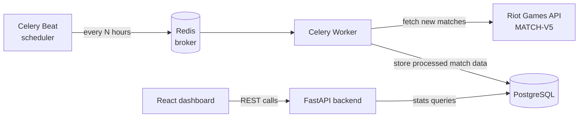

# LoL Performance Tracker

A personal analytics tool for League of Legends solo queue performance, built on real match data pulled directly from Riot Games' API.

## Why this project

In-client stats and sites like OP.GG only show generic aggregates. This project answers more specific, personal questions:

- Does my winrate actually drop after a losing streak, or does it just feel that way?
- Which champions and roles are genuinely carrying my rank right now, not just "feel" strong?
- Does the time of day affect how I perform?

## Features

- Automatic background sync of new ranked solo/duo matches: a scheduled worker pulls new games on its own, no manual refresh
- Idempotent ingestion: already stored matches are skipped, so there is no duplicate data and no wasted API calls
- Riot API client with rate-limit handling (retries on HTTP 429 using `Retry-After`)
- Per-champion and per-role winrate breakdown
- Rolling-window stats (moving average winrate over the last 50 games)
- Time-of-day analysis (winrate per hour, in local time)
- Interactive dashboard with charts
- CI pipeline (GitHub Actions)

## Architecture



Celery Beat periodically queues a sync task in Redis. The worker picks it up, pulls new ranked matches from the Riot API and writes them to PostgreSQL. FastAPI exposes REST endpoints with aggregate statistics computed in SQL (including window functions for the rolling winrate), and a React dashboard renders them as charts.

## Tech stack

| Layer | Technology |
|---|---|
| Backend | FastAPI (Python 3.12) |
| Database | PostgreSQL (psycopg 3) |
| Task queue / scheduling | Celery + Redis |
| Frontend | React (Vite), Recharts |
| Containerization | Docker, Docker Compose |
| CI | GitHub Actions |
| Data source | Riot Games API (MATCH-V5) |

## Project structure

```
LeagueTracker/
├── backend/
│   ├── app/
│   │   ├── services/       # Riot API client, match sync
│   │   ├── db.py           # PostgreSQL access + stats queries
│   │   └── main.py         # FastAPI app
│   ├── worker/
│   │   ├── celery_app.py   # Celery app + beat schedule
│   │   └── tasks.py        # Scheduled match sync task
│   ├── Dockerfile
│   └── requirements.txt
├── frontend/               # React + Recharts dashboard
├── .github/workflows/      # CI
├── docker-compose.yml
└── README.md
```

## Getting started (local development)

1. Clone the repo and copy `.env.example` to `.env`.
2. Fill in `.env`: your Riot API key (get one from the [Riot Developer Portal](https://developer.riotgames.com/)), your Riot ID (`RIOT_GAME_NAME`, `RIOT_TAG_LINE`) and the Postgres credentials.
3. Start the backend stack (Postgres, Redis, API, worker, scheduler):
   ```bash
   docker compose up -d --build
   ```
4. Start the dashboard:
   ```bash
   cd frontend
   npm install
   npm run dev
   ```
5. API docs are available at `http://localhost:8000/docs`, the dashboard at `http://localhost:5173`.

## API endpoints

| Endpoint | Description |
|---|---|
| `GET /health` | Health check |
| `GET /stats/champions` | Games, wins and winrate per champion |
| `GET /stats/roles` | Games, wins and winrate per role |
| `GET /stats/rolling` | Rolling winrate over the last 50 games |
| `GET /stats/hours` | Games, wins and winrate per hour of day |

## Known limitations

- Riot's free development API key expires every 24 hours and has to be refreshed manually from the developer portal. After it expires the sync worker gets HTTP 403 until the key is replaced in `.env` and the containers are restarted. A production key removes this limit but requires an approved application.
- Currently scoped to a single summoner/account (personal tool, not multi-user).
- Statistics for champions and hours with only a few games are not meaningful; the rolling winrate is only fully populated once enough matches are stored.

## Project status

- [x] Riot API client + match ingestion
- [x] Database schema
- [x] Celery worker + scheduled sync
- [x] FastAPI endpoints
- [x] React dashboard
- [x] Dockerized backend, worker and scheduler
- [x] Time-of-day analysis
- [x] CI pipeline
- [x] Session length analysis
- [ ] Cloud deployment (would have to pay, not planned)

## License

MIT
